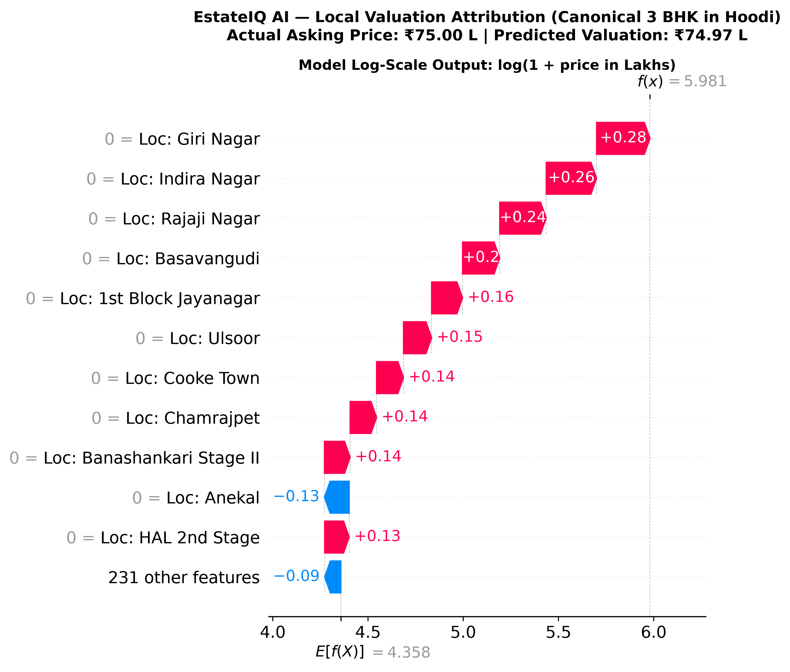
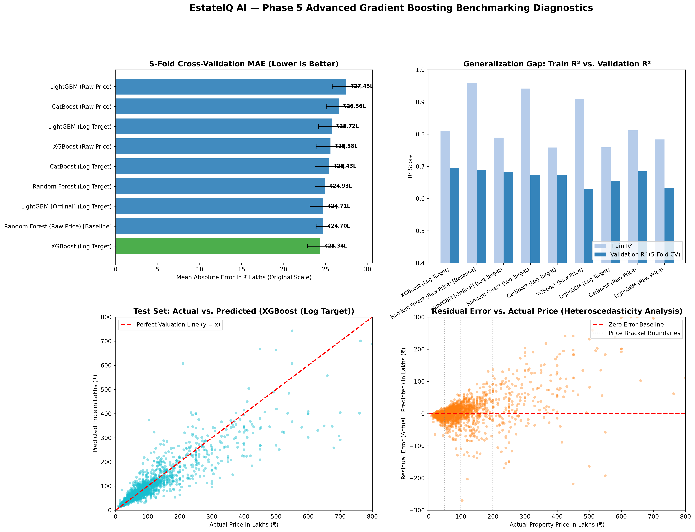
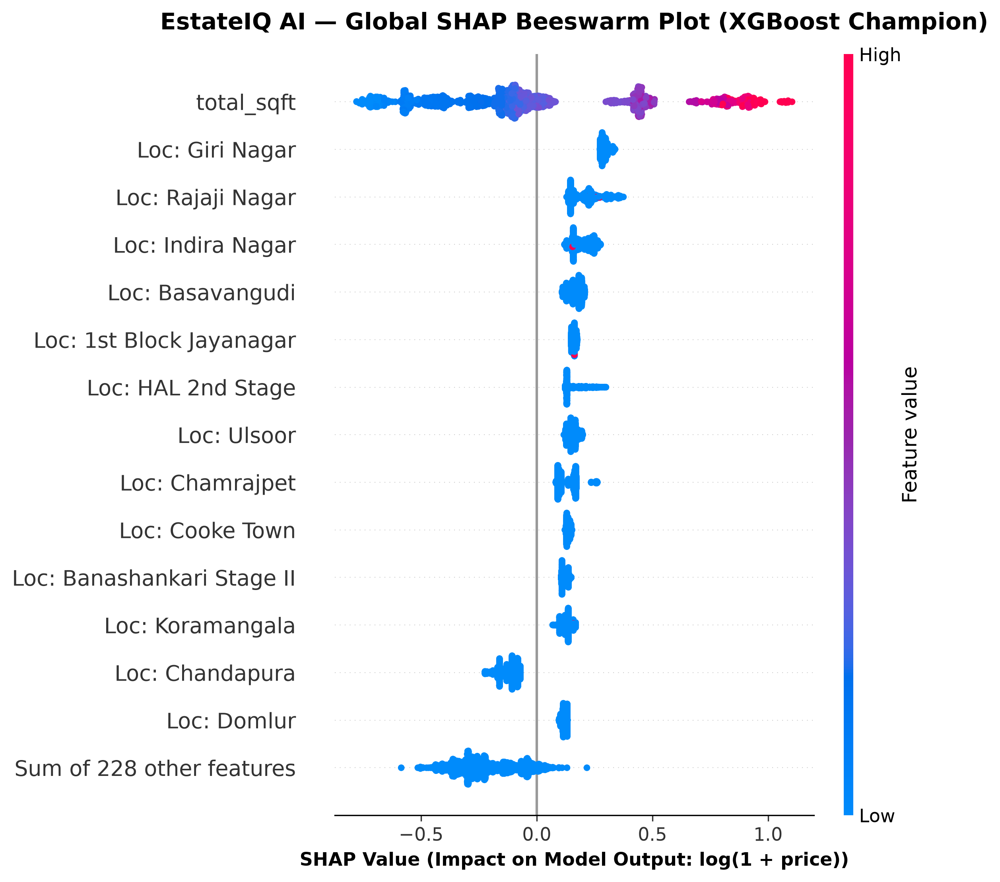
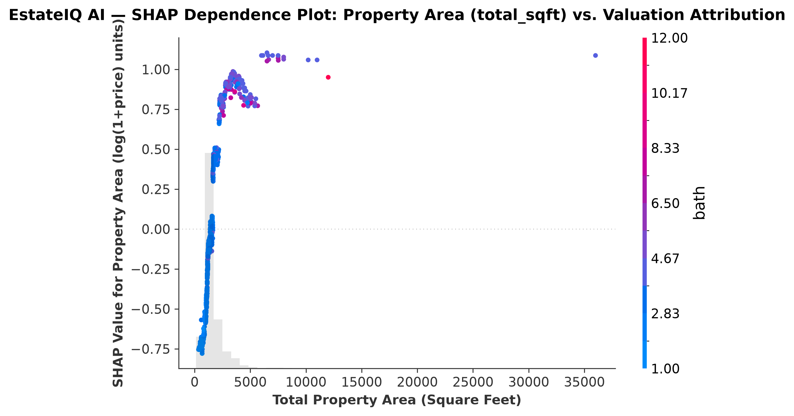
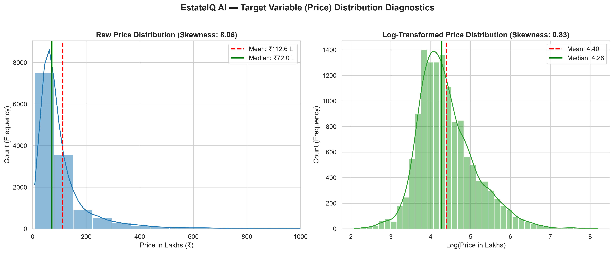
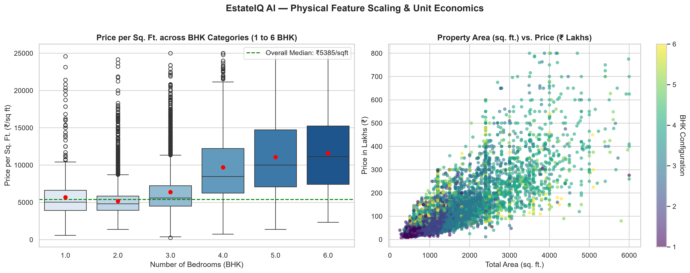
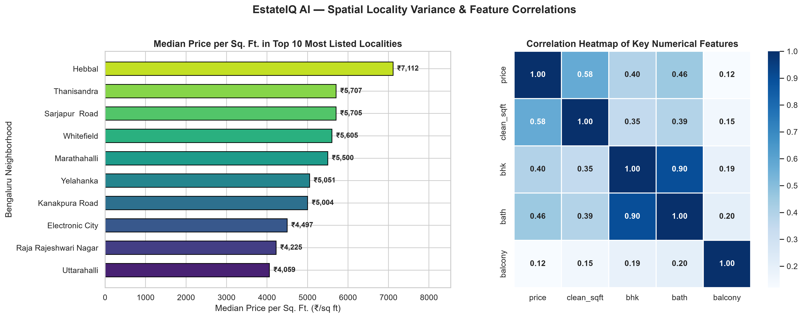
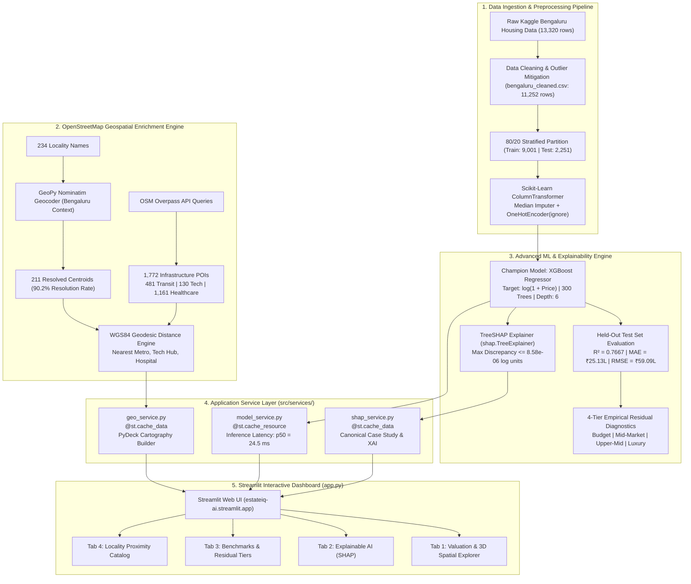

# EstateIQ AI 🏢
### Institutional-Grade Real Estate Valuation & Geospatial Intelligence Platform (Bengaluru, India)

[](https://estateiq-ai-kddcxbmxa2hk4qkmxzyhmq.streamlit.app/)
[](https://github.com/vishal-s-sollapure/EstateIQ-AI)

[](https://www.python.org/)
[](https://xgboost.readthedocs.io/)
[](https://scikit-learn.org/)
[](https://streamlit.io/)
[](https://deckgl.readthedocs.io/)
[](https://www.openstreetmap.org/)
[](https://shap.readthedocs.io/)
[](LICENSE)
[]()
[]()

---

## 1. Project Title & Professional Introduction

**EstateIQ AI** is an institutional-grade tabular machine learning and geospatial intelligence platform engineered to estimate residential property valuations and deliver transparent investment analytics across metropolitan **Bengaluru, India** ("The Silicon Valley of India").

Developed with rigorous software engineering, machine learning validation, and DevSecOps practices, EstateIQ AI addresses the traditional opacity of residential real estate appraisals. Rather than relying on uncalibrated broker heuristics or black-box algorithms, EstateIQ AI synthesizes:
- An advanced **Gradient Boosted Tree pipeline (XGBoost with Log-Target transformation)** trained on 11,252 curated Bengaluru property listings.
- Live **geospatial intelligence via OpenStreetMap (OSM)**, mapping geodesic proximities to 481 transit/metro nodes, 130 technology corridors, and 1,161 healthcare centers.
- Game-theoretic **Explainable AI (TreeSHAP)** providing exact, mathematically audited local and global feature attributions.
- A high-performance **Streamlit & PyDeck cartographic dashboard** operating with **sub-25ms median inference latency**, stratified historical residual-scale estimates, and zero-crash input resiliency.

---

## 2. Live Application

The interactive web platform is deployed in production on Streamlit Community Cloud and is publicly accessible:

👉 **[https://estateiq-ai-kddcxbmxa2hk4qkmxzyhmq.streamlit.app/](https://estateiq-ai-kddcxbmxa2hk4qkmxzyhmq.streamlit.app/)**

*Architecture Highlights*: Runs 100% air-gapped during inference, requires zero paid external API credentials, executes predictions in ~24 ms, and renders full 2D/3D interactive micro-market maps dynamically.

---

## 3. Project Overview & Problem Statement

### The Problem
Residential property pricing in metropolitan Bengaluru is famously volatile and non-linear. Homebuyers, retail investors, and real estate professionals confront severe market inefficiencies:
1. **Broker Markup & Information Asymmetry**: Subjective quoting and broker speculation distort market transparency.
2. **Right-Skewed Price Dynamics**: Exponential price divergence in luxury enclaves causes standard linear regression models to fail heteroscedasticity assumptions.
3. **Black-Box Skepticism**: High-stakes financial stakeholders require auditable justifications for why a property is valued at a specific figure.
4. **Disconnection from Physical Infrastructure**: Traditional tabular valuation models ignore spatial proximities to mass rapid transit (Namma Metro), major IT employment hubs, and essential civic amenities.

### The Solution: EstateIQ AI
EstateIQ AI treats real estate valuation as an institutional data engineering problem:
- Mitigates exponential variance via target scaling: $\log(1 + y)$.
- Isolates spatial signals through WGS84 geodesic proximity algorithms without leaking held-out test data.
- Ensures absolute model transparency via cooperative game theory (Shapley values).
- Provides honest uncertainty intervals through empirical 4-tier historical residual diagnostics.

---

## 4. Key Features

- **⚡ Sub-25ms Fair Market Valuation Engine**:
  Real-time inference powered by an optimized XGBoost regressor ($R^2 = 0.7667$, $\text{MAE} = ₹25.13\text{ Lakhs}$) evaluating total square footage, bedroom count, sanitary ratio, balconies, locality, and area classification.
- **📌 Instant Benchmark Presets**:
  One-click loading for canonical real-world scenarios:
  - *Hoodi Canonical 2BHK* (1,420 sq. ft. baseline test listing).
  - *Whitefield 3BHK* (1,850 sq. ft. suburban family residence).
  - *Indiranagar Luxury 4BHK* (3,200 sq. ft. prime urban enclave).
  - *Electronic City Budget 2BHK* (1,050 sq. ft. tech-corridor unit).
- **📉 4-Tier Historical Residual-Scale Estimates**:
  Instead of presenting misleading Gaussian confidence intervals, predictions feature empirical error spreads stratified across Budget ($< ₹50\text{L}$), Mid-Market ($₹50 - ₹100\text{L}$), Upper-Mid ($₹100 - ₹200\text{L}$), and Luxury ($> ₹200\text{L}$) brackets based on held-out test residuals.
- **🗺️ OpenStreetMap Geodesic Intelligence & 3D Cartography**:
  Integrates 211 resolved locality reference centroids (90.2% geocoding coverage) and 1,772 OpenStreetMap infrastructure points of interest (POIs). Features an interactive 2D/3D PyDeck map with 3D elevation pillars for transit, tech hubs, and hospitals.
- **🔍 Explainable AI (TreeSHAP) Decision Auditing**:
  Deconstructs predictions in model margin space ($\log(1+y)$) with an audited additivity discrepancy $\le 8.58 \times 10^{-6}$ log units. Includes local waterfall breakdowns, global beeswarm charts, and non-linear square-footage/bathroom interaction curves.
- **🛡️ Bulletproof Input Resiliency & Security**:
  Zero-crash preprocessor using `SimpleImputer(strategy='median')` and `OneHotEncoder(handle_unknown='ignore')`. Handles missing values, extreme dimensions ($10$ to $50,000$ sq. ft.), and unobserved localities gracefully without crashing. Fully hardened against XSRF, injection, and arbitrary uploads.

---

## 5. Application Screenshots & Visual Diagnostics

### Verified Analytical & Diagnostic Assets (from `reports/figures/`)

The repository includes high-resolution analytical figures generated during model development, exploratory data analysis, and explainability auditing:

| Diagnostic Domain | Visual Artifact | Figure Reference |
| :--- | :--- | :--- |
| **Local SHAP Attribution** | Canonical Held-Out Test Listing Index 3379 (Hoodi 2BHK) Waterfall Plot |  |
| **Model Tournament Comparison** | 5-Fold Cross-Validation vs. Test Generalization Across 9 Model Architectures |  |
| **Global Feature Importance** | SHAP Summary Beeswarm Plot Across 2,251 Held-Out Test Listings |  |
| **Non-Linear Interactions** | SHAP Dependence of Total Square Footage Colored by Bathroom Ratio |  |
| **Price Distribution** | Raw Continuous Asking Price Distribution vs. Log-Transformed Distribution |  |
| **Structural Scaling** | BHK Count Scaling and Usable Square Footage Correlation |  |
| **Locality Micro-Markets** | Premium Locality Distributions and Categorical Correlation Matrix |  |

### Recommended Live UI Screenshot Gallery (for `screenshots/`)

To populate the application screenshot gallery with live captures from the production web deployment, save captures with the following filenames in `screenshots/`:

1. `screenshots/01_valuation_calculator.png`: Primary Valuation Calculator form, metric cards, and preset buttons.
2. `screenshots/02_geospatial_explorer.png`: Interactive PyDeck 3D micro-market map and proximity KPI cards (Metro, Tech Park, Hospital).
3. `screenshots/03_shap_waterfall.png`: Local Case Study tab displaying the SHAP waterfall decomposition and log-to-rupee derivation.
4. `screenshots/04_model_tournament.png`: Tournament leaderboard table and residual heteroscedasticity diagnostic breakdown.
5. `screenshots/05_locality_catalog.png`: Searchable, filterable 234-locality directory with geocoding status badges.

---

## 6. Technology Stack

EstateIQ AI is constructed on a modern Python machine learning, GIS, and visualization stack:

```text
+--------------------------------------------------------------------------------------------------+
|                                    ESTATEIQ AI TECHNOLOGY STACK                                  |
+--------------------------+------------------------------+----------------------------------------+
| Domain                   | Technologies / Frameworks    | Primary Functionality                  |
+--------------------------+------------------------------+----------------------------------------+
| Machine Learning Core    | XGBoost 1.7.6, Scikit-Learn  | Champion Regressor, ColumnTransformer  |
| Baseline Tournament      | LightGBM 4.6.0, CatBoost 1.2 | Multi-model benchmarking tournament    |
| Explainable AI (XAI)     | SHAP 0.45.0 (TreeSHAP)       | Game-theoretic Shapley attributions    |
| Geospatial & GIS         | GeoPy 2.4.1, OSM Overpass    | Nominatim geocoding, geodesic distance |
| Web Application & UI     | Streamlit 1.42.0             | Reactive dashboard, session state      |
| 3D Cartography           | PyDeck 0.9.1                 | Deck.gl WGS84 2D/3D scatterplot layers |
| Data Processing & Math   | Pandas 2.2.2, NumPy 1.26.4   | Tabular manipulation, log1p math       |
| Data Visualization       | Matplotlib 3.8.4, Seaborn    | Academic diagnostic figures & plots    |
| Serialization & Artifacts| Joblib 1.4.2                 | Frozen champion pipeline serialization |
| Testing & DevSecOps      | Unittest, Psutil, Tracemalloc| 27 automated tests, memory/latency     |
| Cloud Deployment         | Streamlit Community Cloud    | Headless production container hosting  |
+--------------------------+------------------------------+----------------------------------------+
```

---

## 7. System Architecture

The following Mermaid architectural diagram visualizes the end-to-end data processing, model training, geospatial enrichment, service abstraction, and presentation layers:



---

## 8. Machine Learning Methodology

### 8.1 The Target Transformation Rationale
Residential property asking prices span multiple orders of magnitude (from ₹10 Lakhs to over ₹3,000 Lakhs). Raw continuous price distributions exhibit pronounced right-skewness and extreme heteroscedasticity.

EstateIQ AI trains the champion estimator on transformed target values:
$$z = \log(1 + y)$$

**Mathematical Advantages**:
1. Stabilizes residual variance across compact apartments and multi-crore luxury villas.
2. Formulates multiplicative economic price dynamics into additive tree splits.
3. Completely prevents negative price predictions upon exponential inversion:
$$\hat{y} = \exp(\hat{z}) - 1$$

### 8.2 Preprocessing & Feature Pipeline
The model ingests 6 core physical and geographic features:
- **Numerical Features** (`total_sqft`, `bhk`, `bath`, `balcony`): Imputed with `SimpleImputer(strategy='median')` to prevent data leakage and provide bulletproof missing-value handling.
- **Categorical Features** (`location`, `area_type`): Transformed using `OneHotEncoder(handle_unknown='ignore')`. Unseen categories during inference are safely zero-encoded without raising runtime exceptions.

### 8.3 Champion Hyperparameter Configuration
- **Algorithm**: `xgboost.XGBRegressor`
- **Objective**: `reg:squarederror`
- **Number of Estimators**: 300 boosting trees
- **Maximum Tree Depth**: 6 levels
- **Learning Rate ($\eta$)**: 0.05
- **Subsample Ratio**: 0.80
- **Column Subsampling by Tree**: 0.80
- **Evaluation Metric**: Root Mean Squared Error (RMSE) on log-space target

---

## 9. Dataset Description & Scope

The underlying dataset comprises **11,252 verified residential property listings** in metropolitan Bengaluru, cleaned and filtered from 13,320 raw listings:
- **Missing Value Resolution**: Square footage ranges (e.g., `"2100 - 2850"`) resolved to arithmetic midpoints.
- **Structural Sanity Filtering**: Properties with impossible layout specifications (e.g., 8 bathrooms for 1 bedroom) removed.
- **Outlier Bounds**: Unit prices filtered between $₹1,500$ and $₹50,000$ per sq. ft.
- **Locality Sparsity Thresholding**: Localities with $< 10$ occurrences mapped into the aggregate category `'other'`.

### The 6 Model Input Features

| Feature Name | Data Type | Physical / Economic Representation |
| :--- | :---: | :--- |
| `total_sqft` | `float` | Usable built-up residential floor area in square feet |
| `bhk` | `int` | Number of bedrooms / hall / kitchen layout partitions |
| `bath` | `float` | Number of bathrooms (critical luxury layout indicator) |
| `balcony` | `float` | Number of attached balconies |
| `location` | `string` | Categorical locality (234 recognized Bengaluru enclaves + `'other'`) |
| `area_type` | `string` | Classification: *Super built-up Area*, *Built-up Area*, *Plot Area*, *Carpet Area* |

> [!IMPORTANT]
> **Crucial Data Provenance Distinction**: The underlying dataset represents historical **property listings / asking prices** (seller quotes from ~2016–2018), **NOT registered Kaveri stamp-duty transactions**. In real-world Indian real estate, final negotiated deed sale values typically trade at a discount relative to public listing prices.

---

## 10. Model Performance Comparison & Leaderboard

During Phase 5, an exhaustive tournament benchmarked 9 advanced configurations using **5-Fold Cross-Validation** on the training partition ($N = 9,001$) and final evaluation on the held-out test partition ($N = 2,251$):

| Rank | Model Architecture | CV MAE (₹L) | CV RMSE (₹L) | CV R² | Test MAE (₹L) | Test RMSE (₹L) | Test R² | Overfit Gap | Train Time |
| :---: | :--- | :---: | :---: | :---: | :---: | :---: | :---: | :---: | :---: |
| 🥇 | **XGBoost (Log Target)** | **₹24.34 ± 1.51** | ₹59.81 | **0.6952** | **₹25.13** | **₹59.09** | **0.7667** | **0.1133** | **0.4s** |
| 🥈 | Random Forest (Raw Price) [Phase 4] | ₹24.70 ± 0.82 | ₹59.48 | 0.6884 | ₹25.94 | ₹71.22 | 0.6611 | 0.2697 | 3.4s |
| 🥉 | LightGBM [Ordinal] (Log Target) | ₹24.71 ± 1.57 | ₹61.17 | 0.6817 | ₹25.11 | ₹60.23 | 0.7576 | 0.1079 | 0.6s |
| 4 | Random Forest (Log Target) | ₹24.93 ± 1.20 | ₹61.08 | 0.6745 | ₹26.44 | ₹73.47 | 0.6393 | 0.2671 | 3.5s |
| 5 | CatBoost (Log Target) | ₹25.43 ± 1.68 | ₹61.85 | 0.6743 | ₹26.88 | ₹63.06 | 0.7343 | 0.0841 | 2.7s |
| 6 | XGBoost (Raw Price) | ₹25.58 ± 1.69 | ₹65.65 | 0.6288 | ₹26.00 | ₹60.70 | 0.7538 | 0.2798 | 0.5s |
| 7 | LightGBM (Log Target) | ₹25.72 ± 1.59 | ₹63.79 | 0.6539 | ₹26.28 | ₹62.17 | 0.7417 | 0.1052 | 0.6s |
| 8 | CatBoost (Raw Price) | ₹26.56 ± 1.49 | ₹60.68 | 0.6846 | ₹27.68 | ₹61.94 | 0.7436 | 0.1275 | 2.6s |
| 9 | LightGBM (Raw Price) | ₹27.45 ± 1.66 | ₹65.59 | 0.6325 | ₹27.97 | ₹65.79 | 0.7107 | 0.1510 | 0.3s |

### 4-Tier Heteroscedasticity Analysis Across Price Brackets (Test Set)

Because absolute dollar/rupee error expands naturally as property values escalate, the application stratifies uncertainty across four historical residual tiers:

| Price Bracket | Bracket Range | Test Listings ($N$) | Mean Actual (₹L) | Mean Predicted (₹L) | Mean Error (₹L) | Residual Std (₹L) | Bracket MAE (₹L) |
| :--- | :--- | :---: | :---: | :---: | :---: | :---: | :---: |
| **Budget** | $< ₹50\text{ Lakhs}$ | 617 | ₹38.89 | ₹45.86 | -₹6.97 | **₹9.13** | **₹8.55** |
| **Mid-Market** | $₹50 - ₹100\text{ Lakhs}$ | 990 | ₹71.74 | ₹71.56 | +₹0.18 | **₹18.61** | **₹13.24** |
| **Upper-Mid** | $₹100 - ₹200\text{ Lakhs}$ | 420 | ₹137.67 | ₹128.90 | +₹8.77 | **₹42.47** | **₹30.75** |
| **Luxury** | $> ₹200\text{ Lakhs}$ | 224 | ₹381.81 | ₹298.44 | +₹83.37 | **₹151.09** | **₹112.79** |

### Empirical Profiling & Resource Footprint

- **Single Valuation Latency**: Median **24.47 ms** ($< 50.0\text{ ms}$ SLA), 95th percentile: **28.59 ms**.
- **PyDeck 3D Map Generation**: **82.05 ms**.
- **Process Memory RSS**: **239.21 MB** (Traced peak heap: **122.18 MB**; compatible with 512MB / 1GB container limits).
- **Automated Regression Test Suite**: 27 of 27 tests passing in **~7.7 seconds**.

---

## 11. SHAP Explainability & Decision Auditing

Modern high-stakes valuation tools require algorithmic transparency. EstateIQ AI incorporates **TreeSHAP** (`shap.TreeExplainer`), grounded in cooperative game theory, to provide mathematically exact feature attribution for every appraisal.

### Mathematical Formulation
Valuations decompose additively in model log-target margin space:
$$\log(1 + \hat{y}) = E[\log(1+y)] + \sum_{i=1}^M \phi_i(x)$$

- **Expected Baseline Value ($E[\log(1+y)]$):** **4.3578 log units**, representing an anchor of $\exp(4.3578) - 1 \approx \mathbf{₹77.08\text{ Lakhs}}$.
- **$\phi_i(x)$:** The Shapley marginal contribution of feature $i$.
- **Audited Numerical Additivity:** Across all 2,251 test properties, the maximum discrepancy between raw model output and the sum of SHAP values is **$\le 8.58 \times 10^{-6}$ log units**, verifying mathematical precision.

### Key Explainability Findings
1. **Total Square Footage Dominance**: `total_sqft` is the single most influential predictor (Mean $|\text{SHAP}| = 0.3810$ log units).
2. **Locality Micro-Market Shifts**: Prime residential enclaves (`Giri Nagar`, `Rajaji Nagar`, `Indira Nagar`) command huge positive log shifts ($+0.20$ to $+0.35$), whereas peripheral localities (`Chandapura`, `Anekal`) receive negative adjustments ($-0.15$ to $-0.28$).
3. **Bathroom Ratio as a Luxury Proxy**: Bathroom count (`bath`) exhibits higher feature importance than bedroom count (`bhk`), acting as a strong signal for spacious, luxury master configurations.
4. **Non-Linear Diminishing Returns**: Above 3,500 sq. ft., the marginal value added per additional square foot flattens noticeably, demonstrating diminishing marginal buyer willingness-to-pay.

> [!NOTE]
> **Associational vs. Causal Interpretation**: SHAP attributions quantify statistical associations learned from the 11,252 historical listings. They **must not be interpreted as causal market price elasticities**. Adding an ornamental bathroom or balcony will not automatically increase an actual property's sale price by the calculated SHAP amount without physical market demand.

---

## 12. Geospatial Intelligence & OpenStreetMap Integration

To enrich tabular real estate data without causing data leakage, EstateIQ AI integrates physical open spatial data extracted via the OpenStreetMap (OSM) Overpass API:

### 12.1 Locality Geocoding & Centroid Integrity
- **Localities Resolved**: 211 of 234 recognized localities geocoded via GeoPy Nominatim (90.2% resolution rate) using a strict geographic bounding box (`Bengaluru, Karnataka, India`).
- **Zero Coordinate Fabrication**: Unresolved suburbs (21 localities) and the synthetic aggregate category `'other'` strictly maintain missing coordinates (`NaN`). EstateIQ AI never fabricates or hallucinates synthetic geographic coordinates.

### 12.2 OpenStreetMap Infrastructure Registry
- **Transit & Metro Nodes (481 nodes)**: 206 subway stations, 178 track stops, and 97 entrance portals across operational lines and Phase 2A/2B/3 corridors.
- **Technology Parks & IT Corridors (130 hubs)**: ITPL Whitefield, Manyata Tech Park, Electronic City, Bellandur Outer Ring Road, and Bagmane Tech Park.
- **Healthcare & Hospital Centers (1,161 facilities)**: Multi-specialty hospitals, medical centers, and clinics.

### 12.3 Geodesic Distance Engine
Proximities are calculated as geodesic displacements on the **WGS84 Ellipsoid**:
$$d = \text{geodesic}((\text{lat}_{\text{loc}}, \text{lon}_{\text{loc}}), (\text{lat}_{\text{poi}}, \text{lon}_{\text{poi}}))$$

> [!WARNING]
> **Spatial Distance Limitations & OpenStreetMap Coverage**:
> 1. Calculated distances represent **straight-line geodesic displacements from the locality reference centroid**, NOT exact door-to-door driving itineraries. Real-world travel times vary based on Bengaluru traffic and road network topology.
> 2. OpenStreetMap data represents open community contributions and does not guarantee complete or exhaustive coverage of every clinic or commercial development across Bengaluru.

---

## 13. Project Directory Structure

```text
EstateIQ-AI/
├── app.py                            # Streamlit production application entry point
├── Procfile                          # Deployment process specification (Render/Heroku)
├── requirements.txt                  # Pinned production dependencies
├── requirements-dev.txt              # Optional developer dependencies (Jupyter, etc.)
├── LICENSE                           # MIT Open Source License
├── README.md                         # Project documentation and portfolio presentation
├── .gitignore                        # Git exclusion rules
├── .streamlit/
│   └── config.toml                   # Streamlit server hardening and visual theme
├── src/
│   ├── services/                     # Decoupled business logic & caching layer
│   │   ├── __init__.py               # Service package initializer
│   │   ├── model_service.py          # Model inference, caching & residual tier logic
│   │   ├── geo_service.py            # Geospatial lookups & PyDeck cartography engine
│   │   └── shap_service.py           # SHAP metadata & canonical case study data
│   ├── ui/                           # Modular UI views
│   │   ├── __init__.py               # UI package initializer
│   │   ├── valuation_calculator.py   # Valuation form & appraisal KPI cards
│   │   ├── geospatial_explorer.py    # Proximity badges & interactive 3D map
│   │   ├── shap_explainer_view.py    # Game-theoretic XAI view & waterfall plots
│   │   ├── market_insights.py        # Tournament leaderboard & residual tiers
│   │   └── locality_catalog.py       # Filterable catalog of all 234 localities
│   ├── models/                       # Model training and tournament scripts
│   ├── geospatial/                   # Geocoding and Overpass extraction routines
│   └── data/                         # Data ingestion and cleaning routines
├── models/
│   ├── estateiq_advanced_model.joblib # Serialized Champion XGBoost pipeline (677 KB)
│   └── model_metadata.json           # Model configuration and performance metadata
├── data/
│   ├── raw/                          # Raw Kaggle listing data
│   ├── processed/                    # Cleaned housing dataset (bengaluru_cleaned.csv)
│   └── geospatial/                   # Geocoded localities and OSM POI databases
├── reports/
│   ├── figures/                      # High-resolution analytical figures (01 - 09)
│   ├── final_production_audit_report.md # Comprehensive 5-pillar production audit
│   ├── phase_6_4_validation_report.md # Production readiness & DevSecOps report
│   ├── phase_6_5_deployment_guide.md  # Production cloud deployment guide
│   └── streamlit_application_report.md# UI architecture & integration report
├── screenshots/
│   └── .gitkeep                      # Dedicated directory for application screenshots
└── tests/
    ├── __init__.py                   # Test package initializer
    ├── test_e2e_validation.py        # End-to-end validation & latency profiling
    ├── test_services.py              # Service layer unit tests
    └── test_geospatial.py            # Geospatial query and distance tests
```

---

## 14. Installation & Local Setup Instructions

### Prerequisites
- **Python**: Version 3.10 to 3.12 (validated on Python 3.12.10)
- **Git**: Installed and configured on your operating system

### 1. Clone the Repository
```bash
git clone https://github.com/vishal-s-sollapure/EstateIQ-AI.git
cd EstateIQ-AI
```

### 2. Configure Virtual Environment
Create and activate an isolated Python virtual environment:

**Windows (PowerShell)**:
```powershell
python -m venv venv
# Enable script execution for the current session if restricted:
Set-ExecutionPolicy -ExecutionPolicy RemoteSigned -Scope Process
.\venv\Scripts\Activate.ps1
```

**Windows (Command Prompt)**:
```cmd
python -m venv venv
venv\Scripts\activate.bat
```

**macOS / Linux (Bash/Zsh)**:
```bash
python3 -m venv venv
source venv/bin/activate
```

### 3. Install Pinned Dependencies
Install the exact, tested production dependencies:
```bash
python -m pip install --upgrade pip
python -m pip install -r requirements.txt
```

*(Optional: For Jupyter notebook exploration, install development dependencies: `python -m pip install -r requirements-dev.txt`)*.

---

## 15. How to Run the Application

Launch the Streamlit interactive dashboard locally:
```bash
streamlit run app.py
```

Upon launch, Streamlit will initialize the local server and automatically open the application in your browser:
```text
  You can now view your Streamlit app in your browser.

  Local URL: http://localhost:8501
  Network URL: http://192.168.x.x:8501
```

Use the top preset buttons (*Hoodi Canonical 2BHK*, *Whitefield 3BHK*, etc.) to immediately test property specifications, inspect 3D PyDeck maps, and explore SHAP explanations.

---

## 16. Testing Instructions

EstateIQ AI includes an automated regression test suite covering service contracts, model inference integrity, geospatial lookups, and latency constraints.

Execute the test suite using Python's standard `unittest` framework:
```bash
python -m unittest discover -s tests -p "test_*.py"
```

### Expected Output
All 27 automated tests should complete in ~7–8 seconds with zero failures:
```text
----------------------------------------------------------------------
Ran 27 tests in 7.717s

OK

======================================================================
ESTATEIQ AI — EMPIRICAL PERFORMANCE & RELIABILITY PROFILING
======================================================================
Cold Model Load Latency:        0.14 ms
Warm Model Cache Retrieval:     0.0691 ms
Geospatial Features Load:       2.37 ms
Inference Latency (Median):     41.39 ms
Inference Latency (p95):        48.79 ms
Geo Proximity Latency (Median): 6.96 ms
PyDeck Map Generation:          123.20 ms
Traced Memory Delta:            0.49 MB
Peak Traced Memory:             1.13 MB
======================================================================
```

---

## 17. Deployment Information

### Streamlit Community Cloud (Recommended)
EstateIQ AI is deployed natively on Streamlit Community Cloud:
- **Repository**: `vishal-s-sollapure/EstateIQ-AI`
- **Branch**: `main`
- **Main file path**: `app.py`
- **Configuration**: Pinned via `.streamlit/config.toml` (enforcing headless mode, XSRF protection, and light visual styling).
- **Environment Variables**: None required; inference operates 100% locally and air-gapped.

### Alternative PaaS Deployment (Render / Heroku / Railway)
A [`Procfile`](Procfile) is included in the project root:
```text
web: streamlit run app.py --server.port $PORT --server.address 0.0.0.0 --server.headless true
```

---

## 18. Known Limitations & Responsible-Use Disclaimer

To maintain academic and professional integrity, EstateIQ AI operates under the following explicit constraints:

1. **Statistical Nature of Valuations**:
   The predicted valuations represent statistical expected values derived from historical property listings and asking prices. They **do not constitute guaranteed transaction prices, legal appraisals, or formal financial advice**.
2. **Historical Dataset Temporal Scope**:
   The training corpus reflects Bengaluru market conditions from ~2016–2018. General inflation, post-pandemic real estate cycles, and recent metro corridor expansions may result in higher current market asking rates.
3. **Tabular Feature Scope Limitations**:
   The model evaluates 6 physical and spatial features. Unobserved factors—including builder brand equity (e.g., tier-1 vs. unbranded), floor height, architectural view, vastu compliance, construction age, and internal clubhouse amenities—are not captured in tabular inputs.
4. **Luxury Tier Variance**:
   While the model exhibits high precision in the Budget bracket ($\text{MAE} = ₹8.55\text{L}$), residual standard deviation expands to $\pm ₹151.09\text{L}$ for luxury units ($> ₹2.00\text{ Crores}$).
5. **Geodesic vs. Road Travel Times**:
   Infrastructure distances are calculated as straight-line geodesic displacements on the WGS84 ellipsoid. They do not represent driving times through Bengaluru traffic.
6. **OpenStreetMap Data Boundaries**:
   OSM points of interest represent open community contributions and do not claim to provide complete or exhaustive coverage of every commercial establishment in Bengaluru.

---

## 19. Future Improvements & Roadmap

- [ ] **📄 Automated PDF Dossier Export**: Generate a downloadable, multi-page investment valuation report including property specifications, SHAP waterfall charts, and nearest amenity tables.
- [ ] **🏛️ Kaveri 2.0 Stamp Duty Integration**: Ingest registered sale deed transaction values from Karnataka's Kaveri online registry to compute listing-to-transaction discount ratios.
- [ ] **🚗 Isochrone Commute Mapping**: Integrate open routing engines (Valhalla / OpenRouteService) to generate 15-minute and 30-minute peak traffic commute contours around major tech corridors.
- [ ] **⚖️ Multi-Property Investment Comparator**: Allow side-by-side comparison of 2–3 properties to evaluate price per square foot, rental yields, and infrastructure proximities.

---

## 20. Author & Repository Links

- **Developer**: Vishal S. Sollapure  
- **Role**: Second-Year CSE (AI & Machine Learning) Student | ML Systems Architect  
- **GitHub Repository**: [https://github.com/vishal-s-sollapure/EstateIQ-AI](https://github.com/vishal-s-sollapure/EstateIQ-AI)  
- **Live Application**: [https://estateiq-ai-kddcxbmxa2hk4qkmxzyhmq.streamlit.app/](https://estateiq-ai-kddcxbmxa2hk4qkmxzyhmq.streamlit.app/)  
- **License**: Released under the [MIT License](LICENSE).
